# Manual Técnico e Funcional: Módulo de Análise e Auditoria do Monitoramento

> **Arquivo VBA:** `Codes/VBA/modAnaliseMonitoramento.bas`  
> **Nome do Módulo:** `modAnaliseMonitoramento`  
> **Aplicações Alvo:** Pastas de trabalho de Monitoramento Individual (`Monitoramento individual_A4UU_v6.xlsm`, `DPBR`, `GPZ1`, `GQ6S`, `S2IJ`)  
> **Autor da Arquitetura Otimizada:** Equipe de Engenharia / Antigravity  
> **Padrão de Codificação:** Windows-1252 (CP1252 / ANSI) com quebras de linha CRLF (`\r\n`)

---

## 1. Visão Geral e Finalidade

O módulo **`modAnaliseMonitoramento`** é o motor central de governança, conformidade e auditoria de qualidade das planilhas operacionais de **Monitoramento Individual** da Petrobras (Contratos **Lote 1 - IRON MOUNTAIN** e **Lote 2 - POLO BAHIA**).

Sua função essencial é auditar linha a linha os registros operacionais digitados (atendimentos, Ordens de Serviço, solicitações, datas de execução, quantidades, localidades e contratos), identificando **inconsistências cadastrais**, **erros de preenchimento**, **divergências de regras de negócio** e **violações de parâmetros contratuais** antes do fechamento do ciclo de medição mensal.

Todos os apontamentos encontrados são consolidados e registrados na própria linha auditada, exatamente na coluna **Z (`LOG / Auditoria SLA`)**, permitindo aos fiscais de contrato e analistas operacionais:
1. Filtrar instantaneamente todas as ordens com inconformidades pelo autofiltro da planilha;
2. Localizar o campo e a causa exata do erro com identificação explícita de coluna (`(Coluna X): ...`);
3. Corrigir inconsistências antes que os dados sejam consolidados pelo Power Query no Painel Geral de Medição, evitando glosas e devoluções de fatura.

---

## 2. Princípios Arquiteturais e Engenharia de Alta Performance

O módulo foi projetado sob rigorosos padrões de engenharia de software para Excel/VBA, substituindo rotinas legadas lentas baseadas em células ativas por processamento em memória de alto desempenho:

```
┌────────────────────────────────────────────────────────────────────────────────────────┐
│                      FLUXO DE EXECUÇÃO EM MEMÓRIA RAM (ALTA PERFORMANCE)              │
│                                                                                        │
│  [Planilha Monitoramento]  ──(Leitura em Bloco)──>  [Matriz Variant vDados (RAM)]      │
│  [Planilha TabelaA / B]    ──(Carga Prévia)────>  [Dicionários Hash O(1) (RAM)]      │
│                                                              │                         │
│                                                     (Loop Auditoria)                   │
│                                                              ▼                         │
│  [Planilha Monitoramento]  <──(Gravação Única)───  [Matriz Variant vLog (RAM)]        │
│  (Coluna Z + Cores RGB)                                                                │
└────────────────────────────────────────────────────────────────────────────────────────┘
```

### Destaques Técnicos:
* **Execução 100% em Memória RAM ($O(1)$):** Os dados da aba `Monitoramento` (Colunas A a Z) são lidos em uma única operação para a matriz `vDados`. Todas as tabelas de referência (`TabelaA` e `TabelaB`) são indexadas em objetos `Scripting.Dictionary`, permitindo que checagens de domínios, siglas e cruzamentos relacionais ocorram com custo computacional $O(1)$.
* **Gravação Atômica em Bloco:** A matriz de diagnóstico `vLog` é preenchida inteiramente em memória e gravada de uma única vez no intervalo da Coluna Z (`Range(Z3:Z{ul}).Value2 = vLog`).
* **Estilização Visual Automatizada:** A coluna de log recebe coloração automática conforme o diagnóstico:
  * **Com Erro:** Fundo vermelho suave (`RGB(254, 226, 226)`) e texto vermelho escuro (`RGB(153, 27, 27)`);
  * **Conforme / Sem Erro:** Fundo limpo neutro (`RGB(238, 242, 238)`) e texto escuro padrão.
* **Supressão e Restauração de Ambiente:** Durante a auditoria, os recursos `ScreenUpdating`, `DisplayAlerts` e `EnableEvents` são desligados e o cálculo é colocado em modo manual (`xlCalculationManual`), com restauração garantida em bloco `Finally / SairRotina`.
* **Velocidade de Processamento:** O tempo médio de auditoria completa fica entre **40 ms e 135 ms** para centenas de linhas de ordens de serviço.

---

## 3. Estrutura de Procedimentos do Módulo

O módulo é composto por 4 procedimentos principais e 2 funções utilitárias:

| Procedimento | Escopo | Finalidade |
| :--- | :---: | :--- |
| `AnalisarErrosMonitoramentoEGerarLog()` | `Public Sub` | **Ponto de entrada interativo:** Disparado pelo usuário através de botões na planilha. Exibe diálogo de confirmação prévio e tela executiva com resumo dos resultados. |
| `AnalisarErrosMonitoramento_Silencioso()` | `Public Sub` | **Ponto de entrada silencioso:** Utilizado para automações em segundo plano (COM, PowerShell, Power Query, rotinas de integração) sem disparar caixas de diálogo modais (`MsgBox`). |
| `analiseMonitoramento()` | `Public Sub` | **Alias de compatibilidade:** Mantido para garantir que botões legados ou atalhos antigos associados à macro continuem funcionando sem alterações. |
| `ExecutarAnaliseMonitoramento(bSilencioso)` | `Private Sub` | **Procedimento mestre:** Gerencia a suspensão do ambiente, carrega os dicionários, itera as linhas de dados, aplica as validações e grava os resultados na Coluna Z. |
| `AuditarLinhaMonitoramento(...)` | `Private Sub` | **Motor de auditoria individual:** Recebe os dados de uma linha específica, avalia as 24 regras de consistência e monta a string consolidada de erros `sLog`. |
| `CarregarDicionariosReferencia(...)` | `Private Sub` | **Carregamento relacional:** Lê e indexa as tabelas de domínio da aba `TabelaA` e resolve a árvore relacional da `TabelaB` (`Localidade -> Centro -> UF -> Contrato`). |
| `EhHoraValida(vValor)` | `Private Function` | **Validador de horas:** Checa se o prazo de aplicação representa formato válido de horas (decimal, `hh:mm` ou com sufixo `h/hs`), rejeitando datas de calendário. |
| `ExibirResumoAuditoria(...)` | `Private Sub` | **Dashboard executivo:** Formata e exibe a caixa de mensagem final com métricas de tempo de processamento, total de linhas varridas, auditadas e inconsistentes. |

---

## 4. Diagrama de Fluxo da Auditoria por Registro

```mermaid
flowchart TD
    Start(["Início da Auditoria"]) --> ReadRAM["Carga de vDados e Dicionários em RAM"]
    ReadRAM --> LoopRows["Iterar cada Linha r (da 3 à última)"]
    
    LoopRows --> CheckTrigger{"Gatilho de Auditoria:<br/>Situação = 'CO' ou 'AT'?<br/>OU OS Disp. = 'Sim'?<br/>OU Data Fechamento preenchida?"}
    
    CheckTrigger -- "NÃO" --> IgnoreRow["bAuditado = False<br/>Limpa Log prévio da linha"]
    CheckTrigger -- "SIM" --> CheckSit{"Situação é 'CO' ou 'AT'?"}
    
    CheckSit -- "NÃO (NC, CA ou vazia)" --> LogSit["Grava Erro na Coluna C:<br/>Situação incompatível com fechamento/disponibilização"]
    CheckSit -- "SIM" --> NextValidations["Prosseguir com Auditoria Integral"]
    LogSit --> NextValidations
    
    NextValidations --> ValCols["Validação Coluna a Coluna:<br/>• Período Faturamento (B)<br/>• Contrato (D) e UF (E)<br/>• Atividade (F) e Item (G)<br/>• Aplicação (H), Solicitação (I), Chave (J)<br/>• Solicitante (K), Data Solic. (L), Prazo (M)<br/>• Gerência (N), Qtd. Solicitada (O)<br/>• Código OS (P), Data Abertura (Q)<br/>• Data Fechamento & Cronologia (R)<br/>• Prazo Combinado Fiscalização (S)<br/>• Qtd. Atendida (T)<br/>• Sigla Obs (U), Localidade (V)<br/>• OS Disponibilizada (Y)"]
    
    ValCols --> CrossVal1{"Qtd. Solicitada == Qtd. Atendida?<br/>(Cols O e T)"}
    CrossVal1 -- "Diferente" --> LogQtd["Grava Erro (Coluna O e T):<br/>Quantidade solicitada diferente da atendida"]
    CrossVal1 -- "Igual" --> CrossVal2{"Contrato condiz com Localidade?<br/>(TabelaB: Cols D e V)"}
    LogQtd --> CrossVal2
    
    CrossVal2 -- "Divergente" --> LogLoc["Grava Erro (Coluna D e V):<br/>Localidade pertence a outro contrato"]
    CrossVal2 -- "Conforme" --> StoreLog["Armazena sLog na Matriz vLog"]
    LogLoc --> StoreLog
    
    StoreLog --> MoreRows{"Mais linhas?"}
    IgnoreRow --> MoreRows
    MoreRows -- "SIM" --> LoopRows
    MoreRows -- "NÃO" --> WriteFlush["Gravação Atômica na Coluna Z<br/>e Formatação de Cores RGB"]
    WriteFlush --> Done(["Fim da Execução (Exibe Resumo)"])
```



---

## 5. Matriz Completa de Regras de Validação e Mensagens de Log

Cada inconsistência gera um texto padronizado com prefixo identificando a coluna afetada, permitindo buscas e filtros imediatos:

### 5.1 Gatilho de Elegibilidade e Validação de Situação (Coluna C)
| Regra | Condição de Erro | Mensagem Gravada no Log | Justificativa de Negócio |
| :--- | :--- | :--- | :--- |
| **Gatilho Inicial** | Situação $\neq$ `"CO"` e $\neq$ `"AT"` e sem data de fechamento nem disponibilização | *(Linha ignorada / log limpo)* | Chamados abertos ou em andamento não são auditados antes da conclusão. |
| **Situação Vazia** | Situação em branco, mas com `OS Disponibilizada = Sim` e/ou `Data Fechamento` preenchida | `(Coluna C): Situação da OS vazia, porém com <motivo> (exige situação 'CO' ou 'AT'); ` | Se o atendimento foi concluído ou liberado, a situação não pode ficar em branco. |
| **Situação Incompatível** | Situação preenchida com outro status (ex.: `NC`, `CA`, `PE`), mas com fechamento ou liberação | `(Coluna C): Situação da OS '<sit>' incompatível: <motivo> exige situação 'CO' ou 'AT'; ` | Não é permitido registrar data de encerramento em ordens com status de não conformidade ou cancelamento. |

*O `<motivo>` discrimina com exatidão: `'OS disponibilizada' preenchido como 'Sim'`, `data de fechamento preenchida` ou ambos.*

---

### 5.2 Validações Cadastrais e de Domínio (Colunas B a N)
| Coluna / Campo | Condição de Erro | Mensagem Gravada no Log |
| :--- | :--- | :--- |
| **Coluna B:** Período Faturamento | Situação `"CO"` e campo vazio | `(Coluna B): Campo vazio e situação concluída; ` |
| **Coluna B:** Período Faturamento | Formato de data inválido ou com espaços | `(Coluna B): Data inválida; ` |
| **Coluna D:** Contrato | Campo vazio | `(Coluna D): Campo vazio. Preenchimento obrigatório; ` |
| **Coluna D:** Contrato | Valor não cadastrado na `TabelaA` | `(Coluna D): Descrição inválida para a coluna informada; ` |
| **Coluna E:** UF | Campo vazio | `(Coluna E): Campo vazio. Preenchimento obrigatório; ` |
| **Coluna E:** UF | Sigla de estado não cadastrada na `TabelaA` | `(Coluna E): Descrição inválida para a coluna informada; ` |
| **Colunas D e E:** Contrato $\times$ UF | Par Contrato/UF não permitido (ex.: Contrato BA com UF RJ) | `(Coluna D e E): Campo contrato não pertence ao campo UF; ` |
| **Coluna F:** Descrição Atividade | Campo vazio | `(Coluna F): Campo vazio. Preenchimento obrigatório; ` |
| **Coluna F:** Descrição Atividade | Atividade não cadastrada na `TabelaA` | `(Coluna F): Descrição inválida para a coluna informada; ` |
| **Coluna G:** Item | Campo vazio | `(Coluna G): Campo vazio. Preenchimento obrigatório; ` |
| **Coluna G:** Item | Código de item não cadastrado na `TabelaA` | `(Coluna G): Descrição inválida para a coluna informada; ` |
| **Colunas F e G:** Atividade $\times$ Item | Item informado não pertence à atividade selecionada | `(Coluna F e G): Campo item não pertence ao campo atividade; ` |
| **Coluna H:** Aplicação | Campo vazio | `(Coluna H): Campo vazio. Preenchimento obrigatório; ` |
| **Coluna H:** Aplicação | Aplicação não cadastrada na `TabelaA` | `(Coluna H): Descrição inválida para a coluna informada; ` |
| **Coluna I:** Código Solicitação | Campo vazio | `(Coluna I): Campo vazio. Preenchimento obrigatório; ` |
| **Coluna I:** Código Solicitação | Contém caractere de espaço | `(Coluna I): Caractere inválido para texto inserido: Espaço; ` |
| **Coluna J:** Chave Solicitante | Campo vazio | `(Coluna J): Campo vazio. Preenchimento obrigatório; ` |
| **Coluna J:** Chave Solicitante | Contém caractere de espaço | `(Coluna J): Caractere inválido para texto inserido: Espaço; ` |
| **Coluna K:** Nome Solicitante | Campo vazio | `(Coluna K): Campo vazio. Preenchimento obrigatório; ` |
| **Coluna L:** Data Solicitação | Campo vazio | `(Coluna L): Campo vazio. Preenchimento obrigatório; ` |
| **Coluna L:** Data Solicitação | Valor não é uma data válida | `(Coluna L): Data inválida; ` |
| **Coluna M:** Prazo Aplicação | Preenchido com valor que não representa horas (ex.: data de calendário) | `(Coluna M): Hora inválida; ` |
| **Coluna N:** Gerência Solicitante | Campo vazio | `(Coluna N): Campo vazio. Preenchimento obrigatório; ` |
| **Coluna N:** Gerência Solicitante | Contém espaços ou underlines | `(Coluna N): Caractere inválido para texto inserido: Espaço; ` ou `Underline; ` |

---

### 5.3 Validações Quantitativas, Cronológicas e de Prazos (Colunas O a T)
| Coluna / Campo | Condição de Erro | Mensagem Gravada no Log |
| :--- | :--- | :--- |
| **Coluna O:** Qtd. Solicitada | Campo vazio | `(Coluna O): Campo vazio. Preenchimento obrigatório; ` |
| **Coluna O:** Qtd. Solicitada | Valor não numérico | `(Coluna O): Valor numérico inválido; ` |
| **Coluna O:** Qtd. Solicitada | Quantidade $\le 0$ | `(Coluna O): Quantidade solicitada deve ser maior que zero; ` |
| **Coluna P:** Código da OS | Campo vazio | `(Coluna P): Campo vazio. Preenchimento obrigatório; ` |
| **Coluna P:** Código da OS | Contém espaços | `(Coluna P): Caractere inválido para texto inserido: Espaço; ` |
| **Coluna Q:** Data de Abertura | Preenchida, porém não é uma data válida | `(Coluna Q): Data inválida; ` |
| **Coluna R:** Data de Fechamento | Situação `"CO"` e data de fechamento vazia | `(Coluna R): Campo vazio e situação concluída; ` |
| **Coluna R:** Data de Fechamento | Preenchida, porém com valor de data inválido | `(Coluna R): Data inválida; ` |
| **Coluna R:** Cronologia da OS | Data de Fechamento anterior à Data de Abertura ($D_{\text{fech}} < D_{\text{abert}}$) | `(Coluna R): Data de fechamento anterior à data de abertura; ` |
| **Coluna S:** Prazo Combinado | Atividade exige prazo de Fiscalização, mas campo está vazio | `(Coluna S): Prazo obrigatório para atividade informada; ` |
| **Coluna T:** Qtd. Atendida | Campo vazio | `(Coluna T): Campo vazio. Preenchimento obrigatório; ` |
| **Coluna T:** Qtd. Atendida | Valor não numérico | `(Coluna T): Valor numérico inválido; ` |
| **Coluna T:** Qtd. Atendida | Quantidade $< 0$ | `(Coluna T): Quantidade atendida não pode ser negativa; ` |
| **Colunas O e T:** Paridade de Quantidades | Quantidade Solicitada $\neq$ Quantidade Atendida ($Q_{\text{sol}} \neq Q_{\text{atend}}$) | `(Coluna O e T): Quantidade solicitada diferente da quantidade atendida; ` |

---

### 5.4 Validações de Localidade, Contrato Petrobras e Disponibilização (Colunas U a Y)
| Coluna / Campo | Condição de Erro | Mensagem Gravada no Log |
| :--- | :--- | :--- |
| **Coluna U:** Observação / Sigla | Sigla preenchida, mas não cadastrada na `TabelaA` | `(Coluna U): Descrição inválida para a coluna informada; ` |
| **Coluna V:** Localidade | Campo vazio | `(Coluna V): Campo vazio. Preenchimento obrigatório; ` |
| **Coluna V:** Localidade | Localidade não encontrada na base de domínio | `(Coluna V): Informação não encontrada: Localidade; ` |
| **Coluna V:** Localidade | Localidade desativada (`Flag = "N"`) | `(Coluna V): Localidade não ativa. Informe o responsável; ` |
| **Colunas D e V:** Contrato $\times$ Localidade (Tabela B) | Localidade pertence a contrato homologado diferente do informado na Coluna D | `(Coluna D e V): Localidade '<Loc>' pertence ao contrato '<ContratoEsperado>' (UF: <UF>), mas o contrato informado é '<Contrato>'; ` |
| **Colunas D e V:** Contrato $\times$ Localidade (Tabela B) | Localidade informada não existe na base da Tabela B | `(Coluna D e V): Localidade '<Loc>' não cadastrada na TabelaB para validação de contrato; ` |
| **Coluna Y:** OS Disponibilizada? | Campo vazio | `(Coluna Y): Campo vazio. Preenchimento obrigatório; ` |
| **Coluna Y:** OS Disponibilizada? | Preenchido com valor diferente de `<SIM>` ou `<NÃO>` | `(Coluna Y): Permitido apenas <SIM> ou <NÃO>; ` |

---

## 6. Resolução Relacional da Tabela B (Contrato $\times$ Localidade)

Uma das maiores inovações do módulo é o motor relacional que valida a integridade geográfica e jurídica das solicitações. Para cada registro, a rotina navega na árvore de tabelas da **`TabelaB`**:

```
[Localidade Informada (Col V)]
         │
         ▼
[Tabela Localidade] ──(Cols 36-37)──> [Centro Petrobras]
                                             │
                                             ▼
[Tabela Centro]     ──(Cols 38, 45)─> [UF da Prestação]
                                             │
                                             ▼
[Tabela Grupo / Contratos] ──────────> [Contrato Homologado Petrobras]
                                       • IRON-LT1 (SAP 4600686987): RJ, SP, ES, DF, GO, MG, etc.
                                       • PA-LT2   (SAP 4600687006): BA, SE, RN, AM, CE, PE, etc.
                                       • T2M      (SAP 4600617111): RJ
```

### Casos Especiais Atendidos:
1. **Centro Informado Diretamente na Coluna Localidade:** Em diversas frentes operacionais, o usuário digita o nome do próprio Centro (ex.: `PORTO ENCONTRO DAS AGUAS`, `IMBETIBA`, `EDIRN`). O carregador mapeia tanto as localidades filhas quanto os próprios nomes dos Centros, evitando falsos positivos.
2. **Dupla Nomenclatura (Sigla e Código SAP):** Reconhece indistintamente o uso da sigla contratual (`IRON-LT1`, `PA-LT2`) e o número SAP do pedido (`4600686987`, `4600687006`).

---

## 7. Como Utilizar e Operar a Rotina

### Pelo Usuário no Microsoft Excel:
1. Abra a planilha de monitoramento (`Monitoramento individual_<LOTE>_v4.xlsm`).
2. Acesse a aba **`Monitoramento`**.
3. Clique no botão de auditoria existente na planilha (vinculado a `AnalisarErrosMonitoramentoEGerarLog`).
4. Confirme a execução na mensagem inicial.
5. Em frações de segundo, o processo terminará exibindo o resumo de linhas auditadas e inconsistências.
6. Clique na seta do autofiltro da coluna **`LOG / Auditoria SLA` (Coluna Z)** para filtrar e inspecionar os erros.

### Por Linha de Comando / Scripts PowerShell / Background COM:
```powershell
$excel = New-Object -ComObject Excel.Application
$excel.Visible = $false
$excel.AutomationSecurity = 1 # msoAutomationSecurityLow

$wb = $excel.Workbooks.Open("D:\PainelNovo-main\Monitoramento\Monitoramento individual_A4UU_v4.xlsm")
# Disparo silencioso sem janelas modais
$excel.Run("AnalisarErrosMonitoramento_Silencioso")

$wb.Save()
$wb.Close($true)
$excel.Quit()
```

---

## 8. Arquivos Vinculados e Repositório

* **Código Fonte Oficial:** [`Codes/VBA/modAnaliseMonitoramento.bas`](file:///d:/PainelNovo-main/Codes/VBA/modAnaliseMonitoramento.bas)
* **Cópia de Distribuição:** [`Codes/VBA/Funções Novas/modAnaliseMonitoramento.bas`](file:///d:/PainelNovo-main/Codes/VBA/Funções%20Novas/modAnaliseMonitoramento.bas)
* **Extração de Referência:** [`Codes/VBA/vba_extracted_A4UU/modAnaliseMonitoramento.bas`](file:///d:/PainelNovo-main/Codes/VBA/vba_extracted_A4UU/modAnaliseMonitoramento.bas)
* **Pastas de Trabalho Ativas:** Diretório [`Monitoramento/`](file:///d:/PainelNovo-main/Monitoramento/)
* **Base Relacional Geográfica:** [`Tabelas Especificas/TabelaB-V2.xlsx`](file:///d:/PainelNovo-main/Tabelas%20Especificas/TabelaB-V2.xlsx)
