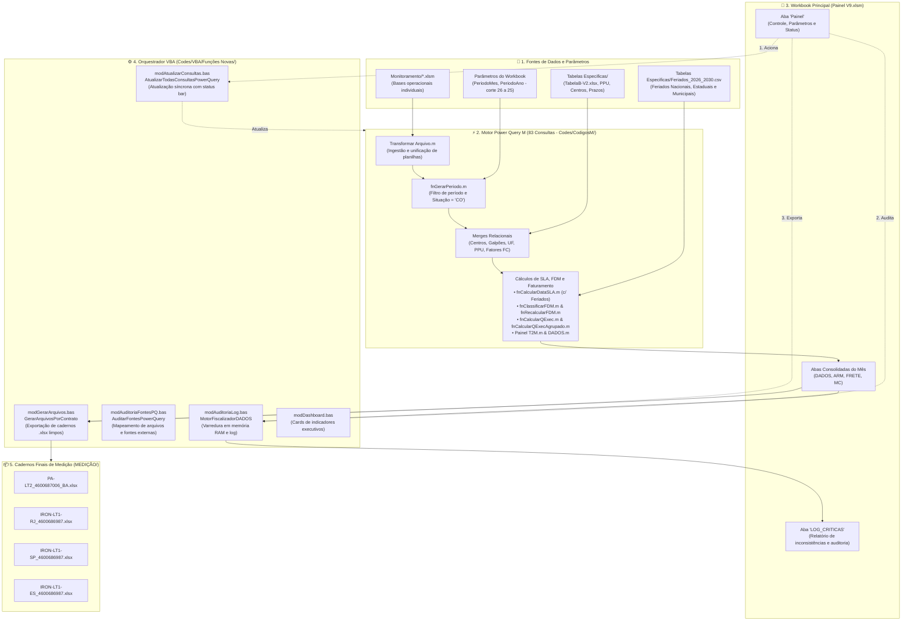

# 📊 Painel de Controle - Memória de Cálculo e Medição Contratual Blueprint

[](https://www.microsoft.com/excel)
[](https://learn.microsoft.com/power-query/)
[](https://learn.microsoft.com/office/vba/api/overview/excel)
[](https://github.com/)

> Solução corporativa de engenharia de dados e automação em Excel, Power Query (Linguagem M) e VBA desenvolvida para consolidação de atendimentos operacionais, apuração estrita de SLA/prazos com suporte a feriados municipais, cálculo de FDM (Fator de Desempenho Mensal), quantificação padronizada (QExec), auditoria preventiva de integridade e geração automatizada de relatórios contratuais de Memória de Cálculo (MC) para contratos de serviços da Petrobras.

---

## 📌 Sumário

- [System Overview](#system-overview)
- [Local Interface & Invariants](#local-interface--invariants)
- [Subdirectories & System Boundaries](#subdirectories--system-boundaries)
- [Global Invariants](#global-invariants)
- [Global Side Effects](#global-side-effects)
- [System Verification](#system-verification)
- [Contratos Atendidos](#-contratos-atendidos)
- [Arquitetura da Solução](#-arquitetura-da-solução)
- [Principais Regras de Negócio](#-principais-regras-de-negócio)
- [Módulo de Auditoria e Qualidade de Dados (`modAuditoriaLog`)](#-módulo-de-auditoria-e-qualidade-de-dados-modauditorialog)
- [Estrutura do Repositório](#-estrutura-do-repositório)
- [Fluxo Operacional (Como Usar)](#-fluxo-operacional-como-usar)
- [Arquivos de Saída](#-arquivos-de-saída)
- [Últimas Alterações e Melhorias Implementadas](#-últimas-alterações-e-melhorias-implementadas)
- [Documentações Técnicas e Manuais Complementares](#-documentações-técnicas-e-manuais-complementares)
- [Requisitos do Ambiente](#-requisitos-do-ambiente)

---

## System Overview

O processo de medição de serviços operacionais corporativos da Petrobras exige a conciliação mensal de milhares de ordens de serviço (OS) e chamados distribuídos entre múltiplos polos de atendimento (BA, RJ, SP, ES) e prestadoras contratadas.

O sistema unifica e automatiza essa esteira operacional de ponta a ponta:

1. **Ingestão Descentralizada:** Lê dinamicamente os cadernos de monitoramento operacional das unidades (`Monitoramento/*.xlsm`).
2. **Transformação & Enriquecimento (ETL em Power Query M):** Padroniza dados textuais, cruza tabelas de referência técnica (`Tabela B`, `PPU`, `Centros`, `Galpões`, `Origem/Destino`, `Feriados`) e filtra apenas registros elegíveis do ciclo.
3. **Motor de Cálculo Especializado:**
   - **SLA Útil:** Determina datas limites de atendimento considerando expediente útil (08:00–17:00), intervalo intrajornada (12:00–13:00) e calendário unificado de feriados nacionais, estaduais e municipais.
   - **FDM:** Classifica indicadores de conformidade de prazo e calcula índices mensais (`TSPE`/`TSPR`, `IAPFARQ`).
   - **QExec:** Aplica fatores de conversão matemática para precificação unificada de volumes heterogêneos.
   - **Frete & Deduplicação de KM:** Calcula quilometragens adicionais e consolida custos de transporte sem cobranças duplicadas na mesma viagem.
4. **Auditoria Preventiva de Integridade:** Módulo VBA dedicado (`modAuditoriaLog.bas`) que fiscaliza a base em memória antes da exportação, gerando diagnósticos na aba `LOG_CRITICAS`.
5. **Geração Automatizada de Entregáveis:** Produz cadernos individuais limpos em formato `.xlsx` na pasta `MEDIÇÃO/`, divididos nas 4 abas contratuais oficiais (`MC`, `ARM`, `DADOS`, `FRETE`).

---

## Local Interface & Invariants

Contratos dos scripts executáveis e de manutenção situados diretamente na raiz do repositório:

### Interface
- `[import_modDemonstrativo.ps1]` - Script PowerShell para automação de injeção e execução silenciosa do demonstrativo de FDM via Excel COM
- `[update_mod_demonstrativo.py]` - Utilitário Python para injeção de diagnóstico de erro SLA em `Codes/VBA/modDemonstrativoFDM.bas`
- `[update_m_queries.py]` - Utilitário Python para correção de chamadas `fnClassificarFDM` com fallback defensivo nas consultas M

### Invariants
- `[update_mod_demonstrativo.py:assert]` A linha `vBaseSaida(nOrdensBase, 20) = vDados(r, colLogSLA)` e a largura de coluna `ws.Columns(20).ColumnWidth = 45` devem existir no módulo VBA alvo antes da mutação.
- `[import_modDemonstrativo.ps1]` A pasta de trabalho alvo deve existir e ser acessível localmente via Microsoft Excel COM.

### Side Effects
- `[import_modDemonstrativo.ps1]` Instancia e encerra processos de segundo plano `excel.exe`, modifica componentes do projeto VBA (`VBComponents.Remove` / `VBComponents.Import`), executa macros e salva a pasta de trabalho.
- `[update_mod_demonstrativo.py:open]` Sobrescreve `Codes/VBA/modDemonstrativoFDM.bas` com codificação Windows-1252 (Latin-1) e quebras de linha CRLF.
- `[update_m_queries.py:open]` Sobrescreve as consultas `Codes/CodigosM/Painel T2M.m` e `Codes/CodigosM/Painel otimizado.m` em UTF-8.

---

## Subdirectories & System Boundaries

- **Codes**: [Codes](./Codes/README.md) - Diretório central do código-fonte da aplicação
  - **CodigosM**: [CodigosM](./Codes/CodigosM/README.md) - Pipeline de Extração, Transformação e Carga (ETL) composto por 83 consultas Power Query M
  - **VBA**: [VBA](./Codes/VBA/README.md) - Módulos de interface, cálculo em memória, auditoria e exportação
    - [Backup_PreRefatoracao](./Codes/VBA/Backup_PreRefatoracao/README.md) - Módulos legados mantidos para histórico
    - [FuncoesAntigas](./Codes/VBA/FuncoesAntigas/README.md) - Rotinas operacionais legadas
    - [Funções Novas](./Codes/VBA/Funções%20Novas/README.md) - Módulos refatorados de alta performance em produção
    - [vba_extracted_A4UU](./Codes/VBA/vba_extracted_A4UU/README.md) - Rotinas e validações das planilhas de monitoramento da ponta
- **scripts**: [scripts](./scripts/README.md) - Utilitários de suporte, injeção COM, higienização de dados e validação de dashboards
- **Docs**: Manuais operacionais, diagnósticos de melhoria e instrumentos jurídicos contratuais da Petrobras
- **Monitoramento**: Pastas de trabalho operacionais individuais (`.xlsm`) preenchidas pelas equipes locais
- **Tabelas Especificas**: Tabelas de apoio dimensional (`TabelaB-V2.xlsx`) e feriados municipais (`Feriados_2026_2030.csv`)
- **MEDIÇÃO**: Destino final dos cadernos oficiais de faturamento (`.xlsx`) desvinculados de conexões externas

---

## Global Invariants

- **Ciclo de Faturamento Operacional:** A apuração contratual não segue o mês civil; compreende estritamente do dia 26 do mês anterior ao dia 25 do mês de referência (`fnGerarPeriodo.m`).
- **Filtro de Elegibilidade:** Apenas atendimentos com `[Situação] = "CO"` e pertencentes aos contratos oficiais `IRON-LT1` e `PA-LT2` integram o faturamento mensal.
- **Jornada de Atendimento Útil:** O prazo de resposta de SLA é computado estritamente em horário comercial (08:00 às 17:00), deduzindo intervalo intrajornada (12:00 às 13:00) e excluindo sábados, domingos e feriados nacionais, estaduais e municipais catalogados.
- **Paridade de Quantitativos:** Toda ordem finalizada exige quantidade solicitada estritamente numérica e positiva, e paridade com a quantidade atendida para conclusão válida.
- **Deduplicação de KM Adicional:** Cobrança de quilometragem excedente à franquia de 100 km faturada exclusivamente na primeira ocorrência de rota/viagem no mesmo dia.
- **Preservação de Fórmulas na Saída:** Os cadernos exportados em `MEDIÇÃO/` preservam fórmulas dinâmicas nativas do Excel (`SOMASE`, subtotais e totais gerais) na aba `MC` vinculadas a tabelas estruturadas recriadas, eliminando dependências externas residuais.

---

## Global Side Effects

- **Instanciação COM:** Automações em PowerShell/Python criam e controlam processos de segundo plano do `excel.exe`.
- **Manipulação de Sistema de Arquivos:** Leitura e gravação de arquivos binários `.xlsm` e `.xlsx` em disco e sincronização de diretórios.
- **Relatórios Integrados:** Geração e sobrescrita de abas de controle (`LOG_CRITICAS`, `Auditoria_Fontes_PQ`, `DEMONSTRATIVO_FDM`) na pasta de trabalho ativa.
- **Geração de Cadernos Finais:** Exportação em lote de 4 arquivos `.xlsx` independentes na subpasta `MEDIÇÃO/`.

---

## System Verification

- Run: `<test-command>` (ou executar `powershell -ExecutionPolicy Bypass -File scripts/verify_dashboard_complete.ps1`)

---

## 🏢 Contratos Atendidos

| Lote / Identificador | Região / UF | Contrato SAP | Instrumento Jurídico | Prestadora / Escopo |
| :--- | :--- | :--- | :--- | :--- |
| **`PA-LT2`** | Bahia (BA) | `4600687006` | Contrato 5900.0133214.25.2 | Serviços de Guarda e Apoio Operacional - Lote 2 |
| **`IRON-LT1-RJ`** | Rio de Janeiro (RJ) | `4600686987` | Contrato 5900.0133210.25.2 | Serviços de Guarda e Apoio Operacional - Lote 1 (RJ) |
| **`IRON-LT1-SP`** | São Paulo (SP) | `4600686987` | Contrato 5900.0133210.25.2 | Serviços de Guarda e Apoio Operacional - Lote 1 (SP) |
| **`IRON-LT1-ES`** | Espírito Santo (ES) | `4600686987` | Contrato 5900.0133210.25.2 | Serviços de Guarda e Apoio Operacional - Lote 1 (ES) |

---

## 🏗 Arquitetura da Solução

O sistema emprega uma **arquitetura híbrida desacoplada**, balanceando a performance relacional em lote do **Power Query M** com a orquestração amigável e automação de planilhas do **VBA**:



---

## ⚖️ Principais Regras de Negócio

### 1. Janela de Faturamento (Ciclo Operacional Petrobras)
- A medição **não segue o mês civil**.
- A apuração é determinada via [`fnGerarPeriodo.m`](Codes/CodigosM/fnGerarPeriodo.m):
  - **Início:** Dia **26** do mês anterior.
  - **Término:** Dia **25** do mês de referência.
  - *Exemplo (Mês Agosto/2026):* Período de `26/07/2026` a `25/08/2026`.

### 2. Filtro de Elegibilidade Contratual
- Apenas atendimentos com status **`Situação = "CO"`** (Concluído) e com data de faturamento/encerramento válida dentro do período participam da apuração oficial. Chamados cancelados ou em andamento são descartados da medição corrente.

### 3. Motor de SLA com Suporte a Feriados Locais ([`fnCalcularDataSLA.m`](Codes/CodigosM/fnCalcularDataSLA.m))
- **Jornada de Trabalho Útil:** Expediente comercial fixado das **08:00 às 17:00**.
- **Intervalo Intrajornada:** Pausa de almoço das **12:00 às 13:00** (não computada na contagem do prazo).
- **Dias Úteis e Calendário:** Segunda a sexta-feira, transpondo automaticamente fins de semana e feriados.
- **Suporte Multilocal de Feriados:** A função recebe parâmetros de Município, UF e a tabela de feriados (integrada na base [`TabelaB-V2.xlsx`](Tabelas%20Especificas/TabelaB-V2.xlsx)), considerando tanto feriados nacionais quanto estaduais e municipais no cálculo do SLA.

### 4. Fator de Desempenho Mensal (FDM)
- Unicidade de apontamento garantida pelo conjunto composto de atendimento.
- Classificação analítica do atendimento: `Normal`, `Expresso`, `Isento` ou `FDM definido`.
- Mensuração dos índices mensais contratuais: `TSPE1`/`TSPR1`, `TSPE2`/`TSPR2` e consolidado `IAPFARQ`.

### 5. Quantidade Executada Padronizada (QExec)
Conversão matemática de itens físicos heterogêneos para as unidades unificadas de cobrança do PPU:
- **Embalagens:** Fator `0,1`
- **Item Avulso:** Fator `0,017`
- **Organização Analítica:** Fator `1,0`
- **Organização Simples:** Fator `0,5`
- **Digitalização e Migração:** Fatores específicos das tabelas de conversão ([`tabela_FC_*`](Codes/CodigosM/tabela_FC.m)).

### 6. Frete e Deduplicação de KM Adicional ([`Painel T2M.m`](Codes/CodigosM/Painel%20T2M.m) & [`fnCalcularQExecAgrupado.m`](Codes/CodigosM/fnCalcularQExecAgrupado.m))
- **Deduplicação de KM Adicional:** Agrupamento por `Rota (Centro <-> Galpão) + Data de Abertura + Linha de Serviço PPU`. Apenas a **primeira ocorrência** do grupo recebe a cobrança de KM excedente ao raio de tolerância.
- **Agrupamento de Frete (QExecAgrupado):** Agrupamento por `Data Fechamento + Localidade Petrobras + Galpão + Linha de serviço PPU`. A inclusão explícita da **Linha de serviço PPU** separa rigorosamente Frete Normal (`FRE-NRM`) de Frete Expresso (`FRE-EXP`). Apenas a primeira ocorrência do grupo calcula a fórmula de frete ($\text{soma}/10$, com piso 1), enquanto as demais ordens da mesma viagem recebem `null`.

---

## 🛡️ Módulo de Auditoria e Qualidade de Dados (`modAuditoriaLog`)

O arquivo [`modAuditoriaLog.bas`](Codes/VBA/Funções%20Novas/modAuditoriaLog.bas) atua como fiscalizador automatizado da base consolidada `DADOS`:

```
┌────────────────────────────────────────────────────────────────────────┐
│                        DESTAQUES DO MÓDULO DE AUDITORIA                │
├─────────────────────────┬──────────────────────────────────────────────┤
│ Mapeamento Dinâmico     │ Não depende de índices fixos de colunas;     │
│ de Cabeçalhos           │ identifica campos por variações de nomes,    │
│                         │ acentuação e quebras de linha (`_x000a_`).   │
├─────────────────────────┼──────────────────────────────────────────────┤
│ Alta Performance        │ Toda a base é carregada e inspecionada na    │
│ em Memória RAM          │ memória, auditando milhares de linhas em     │
│                         │ poucos segundos sem travar a interface.      │
├─────────────────────────┼──────────────────────────────────────────────┤
│ Tipificação de Erros    │ Distingue CRÍTICO (impede faturamento) de    │
│                         │ ALERTA (pendência de atenção do fiscal).     │
├─────────────────────────┼──────────────────────────────────────────────┤
│ Relatório Visual        │ Cria/atualiza a aba 'LOG_CRITICAS' com cards │
│ Integrado               │ executivos, contadores de erros e hiperlinks │
│                         │ diretos para as linhas problemáticas.        │
└─────────────────────────┴──────────────────────────────────────────────┘
```

Para detalhes completos de uso e regras, consulte o [Manual do Módulo de Auditoria](Docs/MANUAL_MODULO_AUDITORIA_LOG.md).

---

## 📁 Estrutura do Repositório

```text
PainelNovo/
│
├── Painel de controle MemoriaPetrobras V.8.6.xlsm # Workbook principal com macros e conexões (Produção)
├── README.md                                    # Blueprint do repositório e visão arquitetural
│
├── Docs/                                        # Documentações técnicas, manuais e contratos
│   ├── ANALISE_COMPLETA_E_SUGESTOES_DE_MELHORIA.md # Diagnóstico holístico, linha do tempo e roadmap
│   ├── MANUAL_MODULO_AUDITORIA_LOG.md           # Manual operacional completo do módulo de auditoria
│   ├── MANUAL_MONITORAMENTO_INDIVIDUAL.md       # Engenharia reversa e guia do monitoramento operacional
│   ├── MANUAL_MONITORAMENTO_INDIVIDUAL_A4UU.md  # Detalhamento específico das rotinas da planilha A4UU
│   ├── MANUAL_FUNCAO_ANALISE_MONITORAMENTO.md   # Manual da rotina de auditoria das planilhas de monitoramento
│   ├── MANUAL_CALCULO_FDM_TSPE_TSPR_IAPFARQ.md  # Manual matemático e metodológico de cálculo do FDM
│   ├── MANUAL_E_ARQUITETURA_DASHBOARD_BI.md     # Manual completo e arquitetura da nova Dashboard BI
│   ├── DOCUMENTACAO_PROJETO.md                  # Mapeamento técnico detalhado de todas as rotinas e funções
│   ├── APONTAMENTOS_E_MELHORIAS.md              # Diagnóstico e catálogo de oportunidades de otimização
│   ├── dashboard_painel_excel.html              # Painel executivo interativo em HTML responsivo
│   ├── Contrato 5900.0133210.25.2 - Lote 1.pdf  # Instrumento jurídico oficial - Lote 1 (RJ, SP, ES)
│   ├── Contrato 5900.0133214.25.2 - Lote 2.pdf  # Instrumento jurídico oficial - Lote 2 (BA)
│   ├── Pontos acordados com Thelmo_07.07.docx   # Registro de alinhamentos e diretrizes operacionais
│   ├── PA.docx                                  # Documento auxiliar de especificações PA
│   └── resumo_projeto_medicao_13-08-2026.txt    # Histórico de apontamentos da migração inicial
│
├── Monitoramento/                               # Pastas de entrada de dados operacionais
│   ├── Monitoramento individual_A4UU_v6.xlsm    # Planilha individual operacional de referência
│   ├── Monitoramento individual_DPBR_v6.xlsm
│   ├── Monitoramento individual_GPZ1_v6.xlsm
│   ├── Monitoramento individual_GQ6S_v6.xlsm
│   └── Monitoramento individual_S2IJ_v6.xlsm
│
├── Tabelas Especificas/                         # Tabelas dimensionais e parâmetros contratuais
│   ├── TabelaB-V2.xlsx                          # Matriz de PPU, SLA, Prazos, Centros, UF e Galpões
│   └── Feriados_2026_2030.csv                   # Base unificada de feriados nacionais e municipais
│
├── Medição - Contratada/                        # Repositório de bases consolidadas intermediárias
│   ├── IRON/                                    # Bases intermediárias de apoio Lote 1
│   └── PA/                                      # Bases intermediárias de apoio Lote 2
│
├── MEDIÇÃO/                                     # Destino final dos cadernos gerados para faturamento
│   ├── IRON-LT1-RJ_4600686987_*.xlsx
│   ├── IRON-LT1-SP_4600686987_*.xlsx
│   ├── IRON-LT1-ES_4600686987_*.xlsx
│   └── PA-LT2_4600687006_BA_*.xlsx
│
├── scripts/                                     # Scripts utilitários de engenharia e automação COM
│   ├── build_professional_dashboard.ps1
│   ├── limpar_planilha_monitoramento.ps1
│   └── ...
│
└── Codes/                                       # Código-fonte desacoplado do Excel
    ├── CodigosM/                                # 83 consultas e funções Power Query M
    │   ├── Painel T2M.m                         # Pipeline principal de cruzamento, SLA e deduplicação
    │   ├── DADOS.m                              # Modelagem da tabela analítica final de atendimentos
    │   ├── fnCalcularDataSLA.m                  # Função de apuração de SLA com suporte a feriados
    │   ├── fnClassificarFDM.m                   # Classificação analítica de FDM
    │   ├── fnCalcularQExec.m                    # Cálculo de quantidade executada padronizada
    │   └── ...
    └── VBA/                                     # Módulos VBA do painel e monitoramento
        ├── Funções Novas/                       # Módulos ativos e otimizados
        ├── FuncoesAntigas/                      # Módulos históricos legados mantidos para rastreabilidade
        ├── Backup_PreRefatoracao/               # Backups de módulos pré-refatoração
        └── vba_extracted_A4UU/                  # Módulos extraídos do monitoramento individual
```

---

## 🚀 Fluxo Operacional (Como Usar)

### Passo 1: Preparação das Entradas
1. Certifique-se de que os arquivos de monitoramento individual do mês estejam atualizados e salvos na pasta `Monitoramento/`.
2. Verifique se a matriz de referência técnica em [`TabelaB-V2.xlsx`](Tabelas%20Especificas/TabelaB-V2.xlsx) contém os parâmetros e a base de feriados (`Calendario`) do período.

### Passo 2: Atualização do Motor de Cálculo
1. Abra o arquivo **`Painel de controle MemoriaPetrobras V.8.6.xlsm`** com as macros habilitadas.
2. Na aba **`Painel`**:
   - Defina o **Mês** e o **Ano** de referência da medição.
   - O intervalo de datas de corte (`26/MM/AAAA` a `25/MM/AAAA`) será atualizado automaticamente.
3. Clique no botão **`Atualizar Consultas`** (ou execute `AtualizarTodasConsultasPowerQuery`):
   - O Power Query executará as 83 consultas M, calculando SLA, FDM, QExec e deduplicações de KM em segundo plano.
   - O progresso poderá ser acompanhado na barra de status do Excel e na célula de controle `F9`.

### Passo 3: Auditoria Preventiva da Base
1. Clique no botão de **`Auditar Dados`** (ou execute a macro `ExecutarAuditoriaComFeedback`):
   - O módulo [`modAuditoriaLog.bas`](Codes/VBA/Funções%20Novas/modAuditoriaLog.bas) inspecionará todas as linhas da aba `DADOS`.
   - Se houver divergências (ex.: datas invertidas, quantidades inconsistentes ou campos vazios), a aba **`LOG_CRITICAS`** será exibida com links diretos para cada linha com apontamento.
   - Corrija os pontos apontados antes de prosseguir com a medição.

### Passo 4: Geração dos Cadernos Contratuais
1. Com os dados auditados e validados, clique no botão **`Gerar Arquivos`** (macro `GerarArquivosPorContrato`).
2. Os cadernos individuais em formato puro `.xlsx` serão criados na pasta `MEDIÇÃO/` com as fórmulas dinâmicas da Memória de Cálculo (`MC`) preservadas e conectadas às bases analíticas locais.
3. Os hiperlinks diretos para os arquivos gerados serão registrados automaticamente na aba `Painel` (células `F14:F17`).

---

## 📦 Arquivos de Saída

Cada arquivo exportado na pasta `MEDIÇÃO/` é um arquivo limpo `.xlsx` (desprovido de macros ou dependências de fontes externas), estruturado em 4 abas padronizadas:

| Aba | Descrição | Conteúdo Principal |
| :--- | :--- | :--- |
| **`MC`** | Memória de Cálculo | Resumo financeiro consolidado por item de serviço, quantidades apuradas, preços unitários (PPU) e valor total a faturar. Preserva fórmulas dinâmicas ativas (`SOMASE`, subtotais e totais) conectadas a `ARM` e `DADOS`, com tabelas estruturadas recriadas e tabelas de apoio convertidas via `BreakLink`. |
| **`ARM`** | Armazenagem | Posição física, saldos em custódia, caixas/metros cúbicos armazenados e valores correspondentes do período (dados analíticos e tabela estruturada recriada). |
| **`DADOS`** | Registros Analíticos | Base completa e auditada de atendimentos com rastreabilidade total: datas, horários, SLA, QExec, OS, localidade e status (dados analíticos e tabela estruturada recriada). |
| **`FRETE`** | Transporte e Deslocamentos | Detalhamento de viagens, coletas, rotas normais/expressas, quilometragem apurada e valores apurados sem duplicidade. |

---

## 🔄 Últimas Alterações e Melhorias Implementadas

| Componente | Tipo de Modificação | Descrição Detalhada |
| :--- | :---: | :--- |
| **Auditoria de Monitoramento Individual (`modAnaliseMonitoramento.bas`)** | **Nova Regra de Negócio & Validação de Contrato x Localidade** | Inclusão da verificação de compatibilidade entre o Contrato informado e a Localidade/UF com base na Tabela B; criação da regra de verificação de Situação da OS (disponibilizada como Sim ou data de fechamento informada com status diferente de CO/AT); e regra de paridade entre Quantidade Solicitada e Atendida. Propagado para todas as 5 pastas de trabalho operacionais (`A4UU`, `DPBR`, `GPZ1`, `GQ6S`, `S2IJ`). |
| **Formatação e Validação de Dados Nativa** | **Padronização de Interface** | Aplicação de regras nativas de validação de dados (`xlValidateDate` entre 01/01/2020 e 31/12/2035) com alerta de interrupção (Stop) e máscaras `dd/mm/aaaa` (Coluna B) e `dd/mm/aaaa hh:mm` (Colunas L, Q, R) em todos os cadernos de monitoramento individual. |
| **Auditoria & Rastreabilidade V.8.6 (`modAuditoriaLog.bas`)** | **Nova Coluna & Rastreabilidade de Origem** | Adição da coluna **Planilha Origem** no relatório executivo `LOG_CRITICAS` e preservação da coluna `Nome da Origem` no Power Query (`Painel T2M.m` / `DADOS.m`). O módulo identifica e exibe com precisão a planilha individual de monitoramento da equipe (ex.: `Monitoramento individual_S2IJ_v6.xlsm`, `DPBR`, `GPZ1`, `GQ6S`, `A4UU`) que originou cada apontamento. |
| **VBA (`modGerarArquivos.bas`)** | **Preservação de Fórmulas & Desconexão de Links** | Refatoração da rotina de exportação dos cadernos contratuais (`GerarArquivosPorContrato`): a aba `MC` preserva fórmulas dinâmicas nativas do Excel (`SOMASE`, subtotais, multiplicadores e totais gerais) conectadas às abas `ARM` e `DADOS` locais, com tabelas estruturadas recriadas (`ARM_<CONTRATO>`, `DADOS_<CONTRATO>`) e eliminação de links externos via `BreakLink`. |
| **Dashboard Executiva BI (Excel)** | **Nova Arquitetura & UX/UI** | Criação da suíte executiva desacoplada em 4 camadas (`00_GUIA`, `01_DASHBOARD`, `04_CALCULOS`, `06_LISTAS`), contendo 6 KPI cards, tabela consolidada por contrato com totalizador, 3 gráficos nativos interativos e segmentação dinâmica de filtros. |
| **Power Query M (`fnCalcularQExecAgrupado.m`)** | Correção de Regra de Negócio | Inclusão de `Linha de serviço PPU` na chave de agrupamento, separando Frete Normal (`FRE-NRM`) de Frete Expresso (`FRE-EXP`). Corrige a supressão de viagens expressas coincidentes em data e rota. |
| **VBA (`modAuditoriaFontesPQ.bas`)** | Nova Funcionalidade | Criação do scanner completo de fontes externas Power Query (`ScanearFontesPowerQuery`), diagnosticando arquivos locais, pastas, conexões OLEDB/ODBC e gerando relatório técnico na aba `Auditoria_Fontes_PQ`. |

---

## 📚 Documentações Técnicas e Manuais Complementares

Para aprofundamento técnico em qualquer componente do ecossistema, consulte os guias dedicados na pasta [`Docs/`](Docs/):

- 📊 [**Manual e Arquitetura da Dashboard Executiva BI**](Docs/MANUAL_E_ARQUITETURA_DASHBOARD_BI.md): Guia de operação, catálogo de fórmulas, design system e arquitetura em 4 camadas no Excel.
- 📖 [**Manual da Rotina de Análise de Monitoramento**](Docs/MANUAL_FUNCAO_ANALISE_MONITORAMENTO.md): Documentação detalhada das 24 regras de validação, mapeamento de colunas e catálogo de erros operacionais.
- 🧮 [**Manual de Cálculo do FDM (TSPE, TSPR e IAPFARQ)**](Docs/MANUAL_CALCULO_FDM_TSPE_TSPR_IAPFARQ.md): Guia metodológico e matemático dos indicadores contratuais.
- 🛡️ [**Manual do Módulo de Auditoria (`modAuditoriaLog.bas`)**](Docs/MANUAL_MODULO_AUDITORIA_LOG.md): Guia passo a passo de como funciona a inspeção em memória, parâmetros e aba `LOG_CRITICAS`.
- 🔍 [**Manual do Monitoramento Individual (A4UU)**](Docs/MANUAL_MONITORAMENTO_INDIVIDUAL.md): Análise técnica detalhada das macros operacionais de coleta da ponta.
- 📐 [**Documentação Técnica Geral do Projeto**](Docs/DOCUMENTACAO_PROJETO.md): Mapeamento exaustivo das 83 consultas M, dicionário de campos e módulos legados.
- 💡 [**Apontamentos e Oportunidades de Otimização**](Docs/APONTAMENTOS_E_MELHORIAS.md): Recomendações de melhores práticas, segurança de código e otimização de performance.

---

## 💻 Requisitos do Ambiente

- **Sistema Operacional:** Microsoft Windows 10 ou Windows 11 (64-bit).
- **Pacote Office:** Microsoft 365 (Recomendado) ou Excel 2019/2021.
- **Configurações no Excel:**
  - Habilitar suporte à execução de macros VBA (`.xlsm`).
  - Permitir acesso a conexões de dados locais e consultas do Power Query (Get & Transform).
  - Permissões de leitura e escrita nas pastas do projeto e nas pastas de rede mapeadas.


